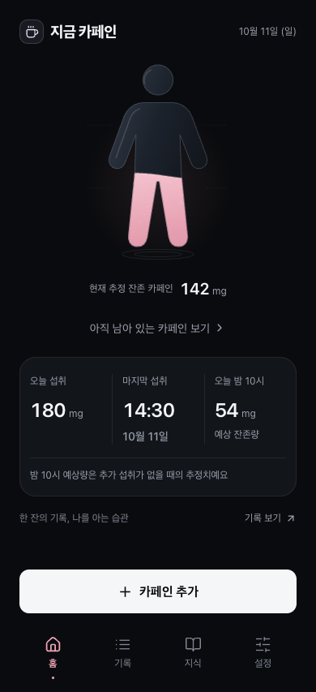
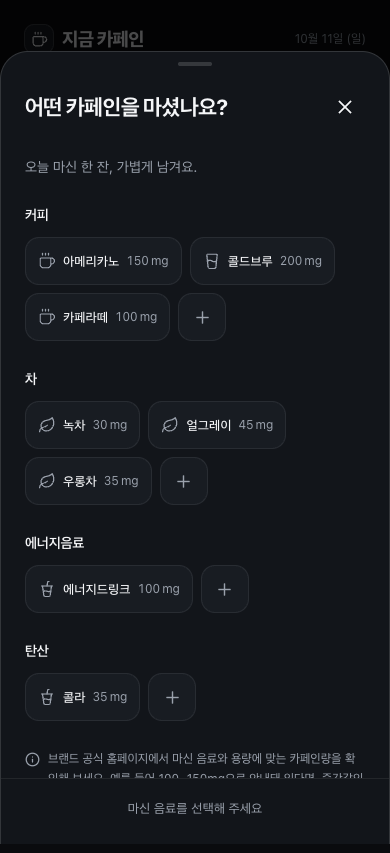
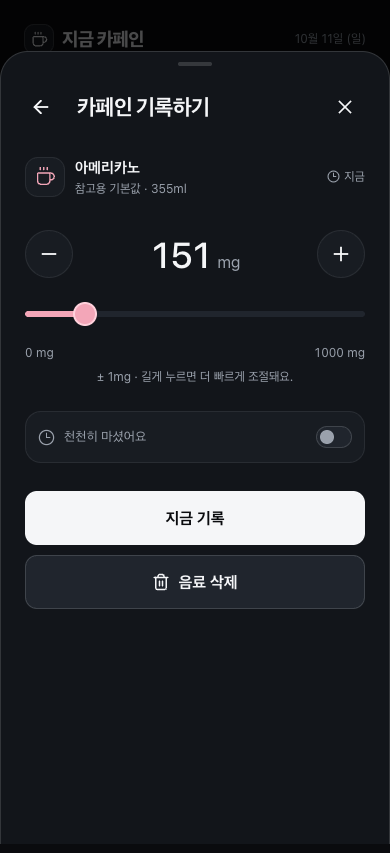
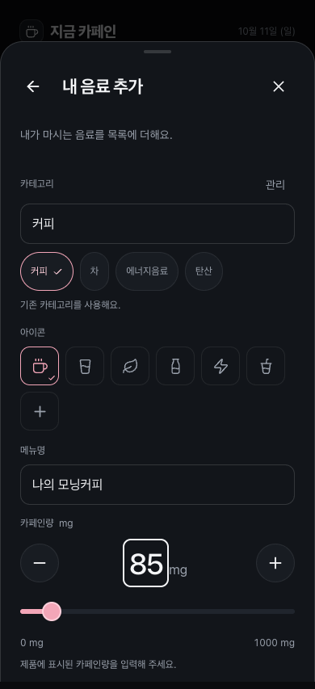
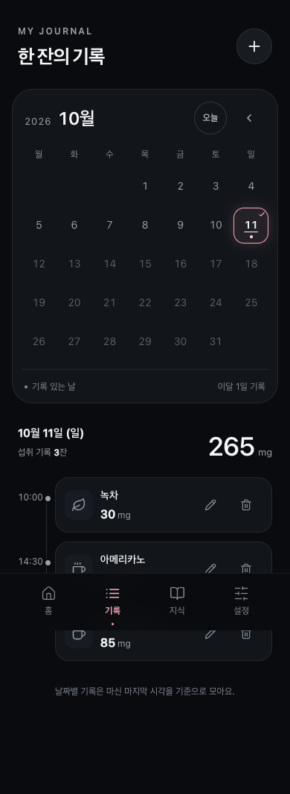
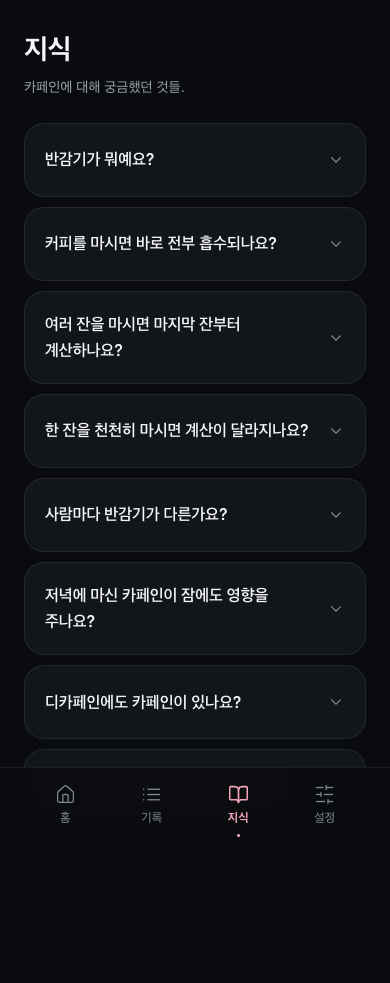
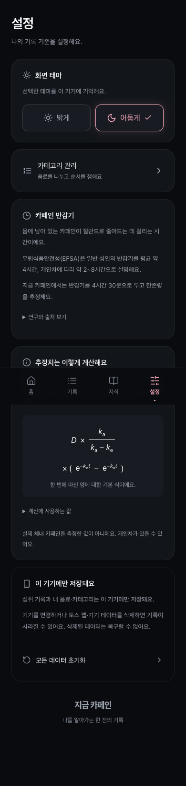
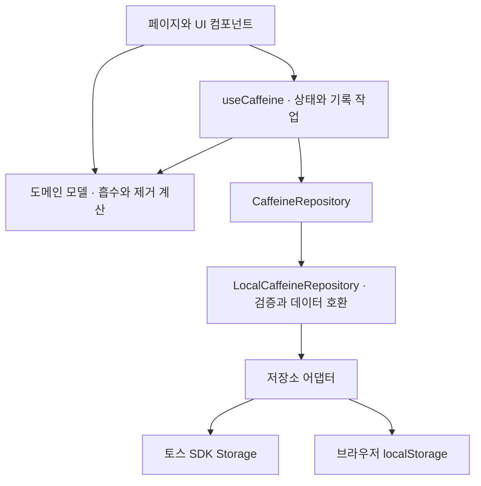

# 지금 카페인

**v1.0.0**

마신 음료를 기록하고, 몸에 남아 있을 것으로 추정되는 카페인량을 확인하는 앱입니다.

카페인량은 추정치이며, 개인차가 있을 수 있어요.

## 지금 내 카페인

현재 추정 잔존량을 캐릭터로 확인해요. 오늘 섭취량, 마지막 섭취 시각과 밤 10시 예상 잔존량도 함께 볼 수 있어요.



## 한 잔 기록하기

음료를 고르고 카페인량과 마신 시각을 조절해 기록해요. 천천히 마신 음료는 시작·종료 시각을 남길 수 있어요. 내 음료는 이름·아이콘 또는 사진·카페인량을 직접 등록해요.

| 음료 선택 | 카페인 기록 | 내 음료 추가 |
| --- | --- | --- |
|  |  |  |

## 날짜별 기록

캘린더에서 날짜별 섭취량과 음료 목록을 확인하고, 기록을 수정하거나 삭제해요. 음료와 카테고리도 직접 관리할 수 있어요.



## 카페인 지식과 설정

카페인에 관한 궁금증을 FAQ와 참고 자료로 살펴봐요. 설정에서는 계산 방식, 화면 테마와 데이터 초기화를 확인할 수 있어요.

| 카페인 지식 | 설정 |
| --- | --- |
|  |  |

## 계산 모델

기록한 섭취량과 시각에서 **흡수된 뒤 아직 제거되지 않은 카페인량(mg)**을 추정합니다. 1구획 약동학 모델에 1차 흡수·제거를 적용하며, [pharmacokinetics.ts](src/features/caffeine/model/pharmacokinetics.ts)에 구현되어 있습니다.

한 시점에 섭취한 음료의 계산식은 다음과 같습니다.

```text
ke = ln(2) / H
A(t) = D × ka / (ka − ke) × (exp(−ke × t) − exp(−ka × t))
G(t) = D × exp(−ka × t)
전체 추정 잔존량 = 각 기록의 A(t) 합계
```

| 기호 | 의미 | 앱에서 사용하는 값·단위 |
| --- | --- | --- |
| D | 기록한 카페인 섭취량 | mg |
| t | 섭취 후 경과 시간 | 시간 |
| ka | 흡수 속도 상수 | 4.54 /시간 · Terziivanov 등(2003)의 집단 추정값 참고 |
| H | 제거 반감기 | 4.5시간 · 앱의 고정 계산 기준 |
| ke | 제거 속도 상수 | ln(2) / 4.5 ≈ 0.154 /시간 |
| A(t) | 흡수된 뒤 남아 있는 추정량 | 홈과 시각화에 사용하는 mg |
| G(t) | 아직 흡수되지 않은 추정량 | 잔존량과 별도로 계산 |

생체이용률은 `F = 1`, 즉 섭취량이 최종적으로 모두 흡수된다고 가정합니다. 반감기 4.5시간은 개인에게서 측정한 값이 아니며, Terziivanov 연구의 제거 속도 `0.139 /시간`을 그대로 사용한 것도 아닙니다.

- **여러 잔:** 이전 날짜의 기록도 각자의 섭취 시각부터 계산해 합산합니다.
- **천천히 마신 음료:** 시작부터 종료까지 일정한 속도 `D / 섭취 기간`으로 마셨다고 가정하고 같은 흡수·제거 모델을 적분합니다.
- **미래 예상량:** 현재까지 마신 분량만으로 미래 시각의 잔존량을 계산합니다. 이후 추가 섭취는 가정하지 않습니다.
- **오늘 섭취량:** 잔존량과 구분해, 섭취 종료 시각이 오늘인 기록의 섭취량을 합산합니다.

흡수가 진행되는 동안에는 추정 잔존량이 먼저 증가할 수 있습니다. 같은 상수를 모든 음료에 적용하므로 실제 함량, 음식, 개인 대사와 모금별 패턴의 차이는 반영하지 못합니다. 혈중 농도나 수면 가능 시각을 측정하는 서비스가 아니며, 반올림된 0mg가 완전 제거를 뜻하지 않습니다.

구간 섭취의 수식과 예시는 [계산 모델 문서](docs/research/oral-caffeine-model.md)에 있습니다.

## 참고 논문

모델의 구조와 기본값을 정할 때 아래 연구를 참고했습니다. 논문에서 검토한 대상과 조건은 앱 사용자 전체를 대표하지 않으며, 해당 연구가 이 앱의 개인별 예측 정확도를 검증한 것은 아닙니다.

| 연구 | 개발에 참고한 내용 |
| --- | --- |
| [Terziivanov 등 (2003) · 성인의 카페인 집단 약동학 분석](https://pubmed.ncbi.nlm.nih.gov/14674790/) | 성인 34명의 자료에서 추정한 흡수 속도 `ka = 4.54 /시간`을 기본값으로 사용합니다. |
| [Seng 등 (2009) · Population pharmacokinetics of caffeine in healthy male adults using mixed-effects models](https://pubmed.ncbi.nlm.nih.gov/19125908/) | 성인 남성 59명의 자료를 설명한 1구획·1차 흡수·1차 제거 구조를 참고했습니다. 비흡연자의 반감기는 약 4.3 ± 1.5시간으로 보고됐으며, 앱의 4.5시간은 별도 고정 가정입니다. |
| [Blanchard & Sawers (1983) · The absolute bioavailability of caffeine in man](https://pubmed.ncbi.nlm.nih.gov/6832208/) | 경구 카페인의 거의 완전한 생체이용률 결과를 `F = 1` 근사의 참고 근거로 사용했습니다. |
| [White 등 (2016) · 음료 종류·온도·섭취 속도에 따른 카페인 약동학 비교](https://pmc.ncbi.nlm.nih.gov/articles/PMC4898153/) | 2분과 20분 섭취 조건의 비교를 검토했습니다. 앱의 일정 섭취 가정이나 장시간 섭취 예측을 직접 검증한 연구로 해석하지 않습니다. |

추가 문헌과 연구별 한계는 [문헌 근거 문서](docs/research/caffeine-evidence.md)에 있습니다. 카페인 FAQ는 별도의 논문·공식 자료도 참고하며 각 답변에서 출처를 제공합니다.

## 기술 스택

| 영역 | 기술 |
| --- | --- |
| 화면 | React 18, TypeScript 5.9 |
| 빌드 | Vite 8 |
| 실행 환경 | Apps in Toss WebView, `@apps-in-toss/web-framework` 3.7 |
| 스타일·시각화 | CSS, 직접 작성한 SVG, Lucide 아이콘 |
| 상태·화면 이동 | React Hooks, 브라우저 History API 기반 라우터 |
| 저장 | Repository 인터페이스, 토스 SDK Storage / 브라우저 localStorage 어댑터 |
| 검증 | Vitest, Playwright, ESLint, TypeScript 타입 검사 |

## 아키텍처

화면, 계산, 저장소, 토스 연동을 나눠 관리합니다. UI는 저장소에 직접 접근하지 않고 `useCaffeine`과 Repository를 통해 기록을 읽고 저장합니다.



| 위치 | 역할 |
| --- | --- |
| [src/app/](src/app/) | 앱 구성, 화면 이동과 오버레이 관리 |
| [src/pages/](src/pages/) | 홈·기록·카페인 지식·설정 등 화면 |
| [src/features/caffeine/components/](src/features/caffeine/components/) | 카페인 시각화와 음료 기록 UI |
| [src/features/caffeine/model/](src/features/caffeine/model/) | 흡수·제거 계산, 시간·입력 검증과 음료 데이터 처리 |
| [src/features/caffeine/hooks/](src/features/caffeine/hooks/) | 상태 갱신과 기록 작업, 저장 실패 처리 |
| [src/features/caffeine/repository/](src/features/caffeine/repository/) | 저장소 인터페이스와 저장 데이터 검증·호환 |
| [src/integrations/toss/](src/integrations/toss/) | 토스 환경 감지, 저장소 어댑터, Safe Area와 뒤로가기 연동 |

계산 테스트는 수치 적분과 비교해 수식·합산·경계 조건을 검증하고, 브라우저 테스트는 기록·수정·삭제와 데이터 유지 흐름을 확인합니다. 이는 구현 검증이며 임상적 정확도 검증과는 구분합니다.

버전별 기능과 스크린샷, 변경 내용은 [GitHub Releases](https://github.com/whitewise95/caffeine-tracking/releases)에 기록합니다.
