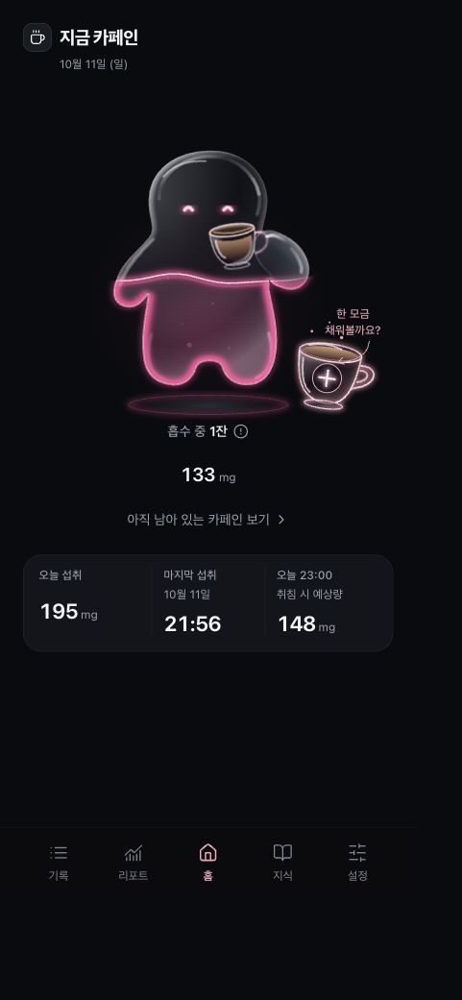
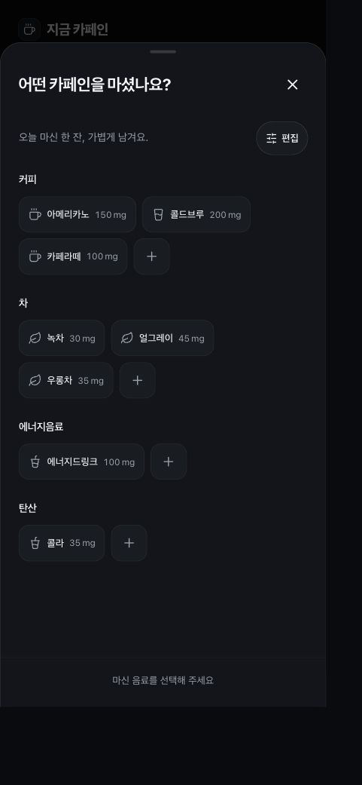
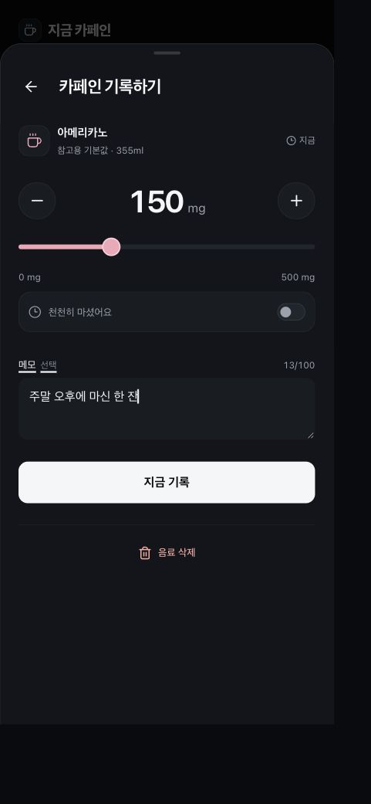
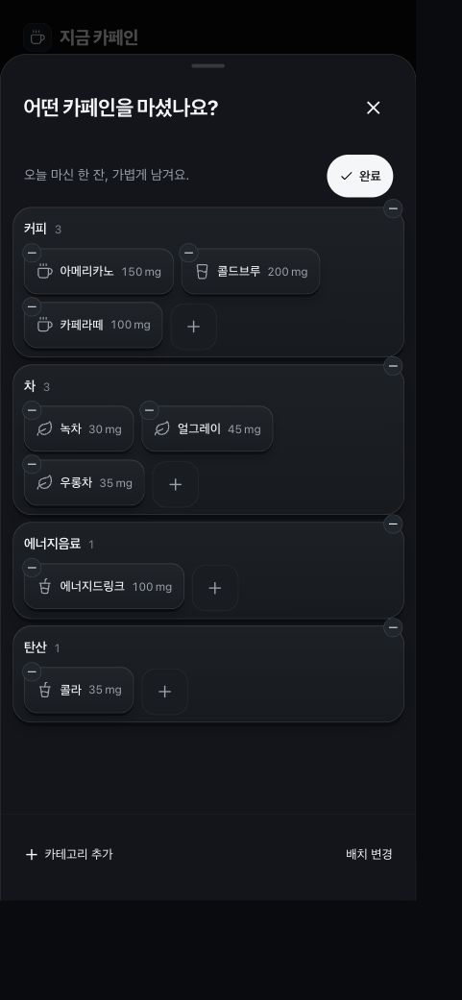
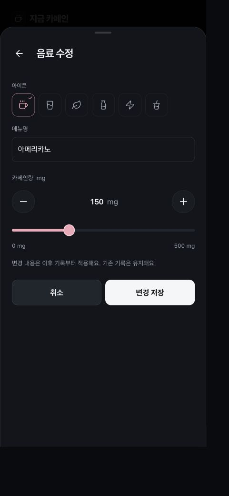
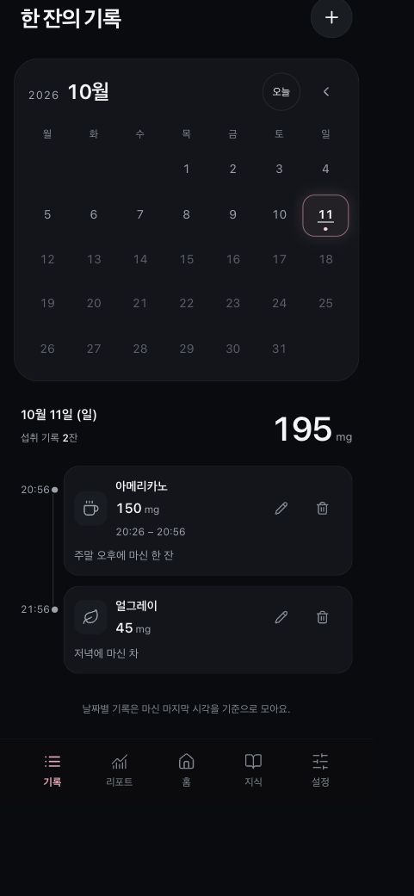
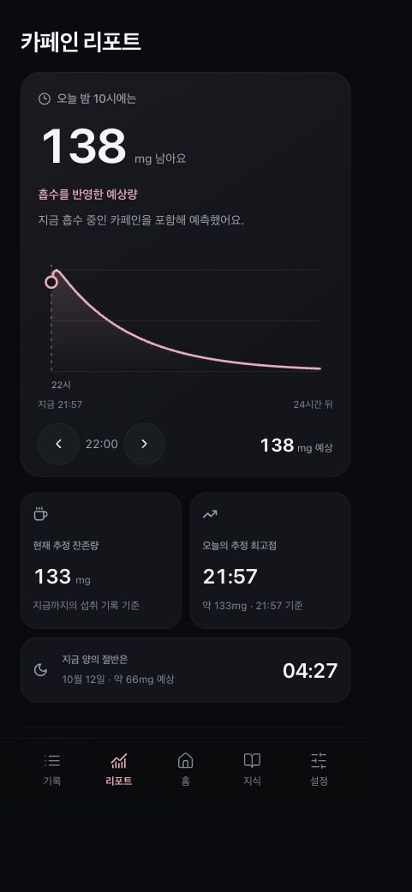
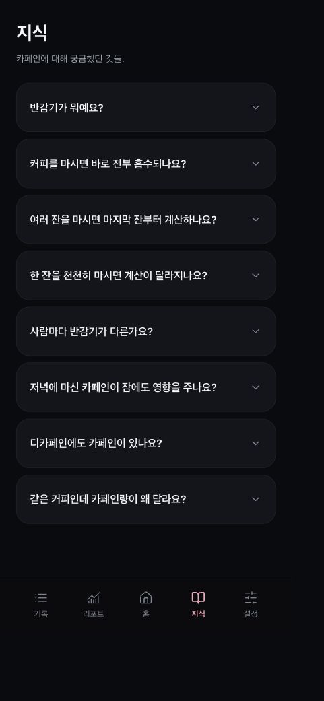
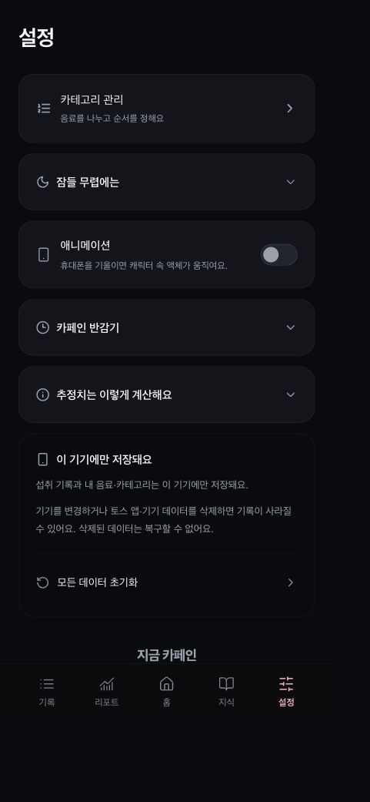
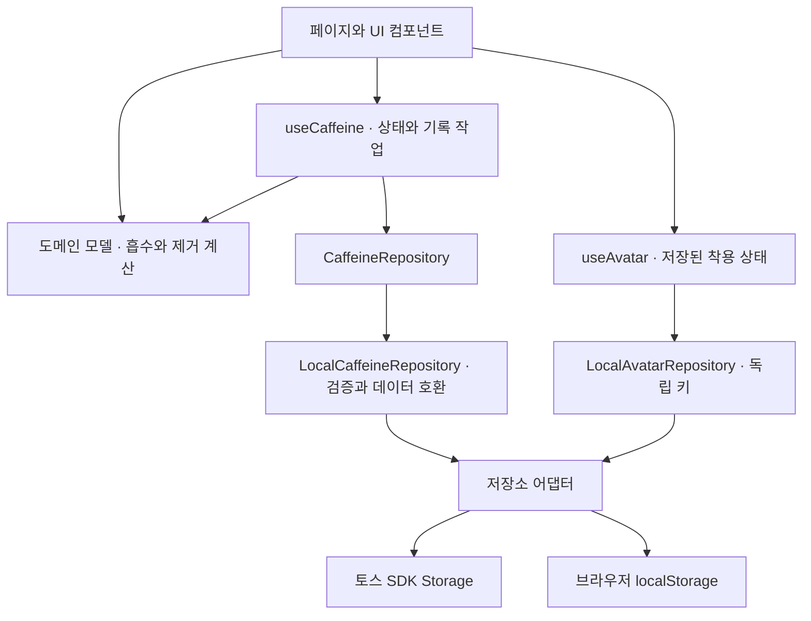

# 지금 카페인

**최근 GitHub 릴리즈: v1.1.0**

현재 브랜치에는 이후 개선 사항도 포함되어 있습니다. 2026년 10월 14일 토스 테스트 버전 `20261014-15`로 등록했으며, 해당 버전은 사용자 테스트 후 검토 요청했으며, 새 GitHub Release나 토스 정식 출시는 아직 진행하지 않았습니다. 현재 소스의 한 번에 / 천천히 시각 선택 개선은 이 테스트 버전 이후 작업입니다. [테스트 빌드 정보](docs/toss-test-build.md)

마신 음료를 기록하고, 몸에 남아 있을 것으로 추정되는 카페인량을 확인하는 앱입니다.

카페인량은 추정치이며, 개인차가 있을 수 있어요.

## 지금 내 카페인

현재 추정 잔존량을 액체가 채워지는 캐릭터로 확인해요. 오늘 섭취량, 마지막 섭취 시각과 설정한 취침 시각의 예상 잔존량도 함께 볼 수 있어요.



## 젤리 캐릭터 꾸미기

홈의 옷걸이 ‘꾸미기’ 버튼으로 들어가 모자·안경·상의·하의·신발·소품을 고를 수 있어요. 각 부위에 50종, 총 300종을 처음부터 사용할 수 있으며, 기존 젤리의 유리 질감·액체·표정과 컵을 든 자세 위에 SVG 의상을 합성해요. 썸네일도 실제 착용 그래픽을 사용해요. 기존 기본 아이템에 포근한·로맨틱·스트리트·클래식·판타지 다섯 컨셉의 의상과 소품을 더했어요.

선택은 미리보기에 바로 반영하고 ‘적용하기’가 성공하면 홈으로 돌아가요. 부위별 ‘착용 안 함’과 ‘모두 벗기기’도 적용 전까지는 미리보기이며, 뒤로가기는 저장하지 않은 선택을 버려요. 실패하면 미리보기를 유지한 채 재시도할 수 있어요. 착용 상태는 기기에 저장하고 새로고침 후 복원해요. 상점·계정 동기화·사용자 이미지 업로드는 없어요.

이 기능은 아직 GitHub Release나 토스 테스트 버전에 포함하지 않았어요. [꾸미기 구현 기록](docs/jelly-wardrobe.md) · [300종 컬렉션·개발 화면](docs/jelly-collection.md)

## 한 잔 기록하기

음료를 고르고 카페인량과 메모를 남겨 기록해요. 기록과 수정 화면에서 한 번에 / 천천히 마시기를 선택해요. 한 번에 마시기는 작은 설정 바에서 날짜·시각을 각각 누르고, 천천히 마시기는 같은 설정 바를 시작·종료 두 줄로 보여줘요. 천천히 마시기의 시작을 바꾸면 종료를 30분 뒤로 맞추며, 현재를 넘으면 현재 시각까지만 반영해요. 현재 기록·수정 화면에서 종료 날짜나 시각을 한 번 직접 변경한 뒤에는 시작을 바꿔도 종료값을 유지해요. 내 음료는 이름·아이콘 또는 사진·카페인량을 직접 등록해요.

| 음료 선택 | 카페인 기록 |
| --- | --- |
|  |  |

## 음료와 카테고리 편집

음료 선택 화면에서 편집을 켜면 배지와 카테고리를 끌어 순서를 바꾸고 음료를 다른 카테고리로 옮길 수 있어요. 이동 중 배치를 바로 확인하며, 작은 삭제 표시로 삭제할 수 있어요. 카테고리를 탭하면 제목 자리에서 이름을 바꾸고, 음료를 탭하면 아이콘·이름·기본 카페인량을 수정해요. 음료 수정은 이후 기록부터 적용하며 기존 기록은 유지해요. 편집 중 변경은 임시 미리보기이며 완료를 눌러 한 번에 저장해요. 상단의 초기화는 편집 시작 전 상태로 되돌리고, 닫기·뒤로가기는 저장하지 않은 변경을 취소해요.

| 배치 편집 | 음료 정보 수정 |
| --- | --- |
|  |  |

## 날짜별 기록

기록 화면은 오늘을 기본 선택해요. 캘린더는 리포트와 같은 색상으로 하루 기록 수를 보여주며, 날짜별 섭취량과 음료 목록을 확인하고 기록을 수정하거나 삭제할 수 있어요. 리포트에서 특정 날짜의 기록을 열면 해당 날짜를 선택해요.



## 카페인 리포트

24시간 예상 잔존량과 오늘의 추정 최고점, 지금 양의 절반이 되는 예상 시각을 살펴봐요. 오늘·7일·이번 달의 섭취 그래프, 기록에서 발견한 패턴과 월간 요약도 볼 수 있어요.



## 카페인 지식과 설정

카페인에 관한 궁금증, 반감기와 추정 계산 방식을 지식 화면의 FAQ·참고 자료로 살펴봐요. 설정에서는 취침 시각, 기울임 애니메이션과 데이터 초기화를 관리해요. 음료·카테고리 관리는 음료 선택 화면의 편집 모드에서 제공해요.

| 카페인 지식 | 설정 |
| --- | --- |
|  |  |

스크린샷은 v1.1.0 브라우저 개발 빌드의 다크 화면에서 가상 기록으로 촬영했어요. 뷰포트는 390 × 844 CSS px이며, 저장된 JPEG는 화면 배율에 따라 481 × 1041px입니다. 이전 버전 화면은 해당 [GitHub Release](https://github.com/whitewise95/caffeine-tracking/releases/tag/v1.0.0)에 보관돼 있어요.

## 계산 모델

기록한 섭취량과 시각에서 **흡수된 뒤 아직 제거되지 않은 카페인량(mg)**을 추정합니다. 1구획 약동학 모델에 1차 흡수·제거를 적용하며, [pharmacokinetics.ts](src/features/caffeine/model/pharmacokinetics.ts)에 구현되어 있습니다.

한 시점에 섭취한 음료의 계산식은 다음과 같습니다.

```text
ke = ln(2) / H
A(t) = D × ka / (ka − ke) × (exp(−ke × t) − exp(−ka × t))
G(t) = D × exp(−ka × t)
전체 추정 잔존량 = 각 기록의 A(t) 합계
```

| 기호 | 의미 | 앱에서 사용하는 값·단위 |
| --- | --- | --- |
| D | 기록한 카페인 섭취량 | mg |
| t | 섭취 후 경과 시간 | 시간 |
| ka | 흡수 속도 상수 | 4.54 /시간 · Terziivanov 등(2003)의 집단 추정값 참고 |
| H | 제거 반감기 | 4.5시간 · 앱의 고정 계산 기준 |
| ke | 제거 속도 상수 | ln(2) / 4.5 ≈ 0.154 /시간 |
| A(t) | 흡수된 뒤 남아 있는 추정량 | 홈과 시각화에 사용하는 mg |
| G(t) | 아직 흡수되지 않은 추정량 | 잔존량과 별도로 계산 |

생체이용률은 `F = 1`, 즉 섭취량이 최종적으로 모두 흡수된다고 가정합니다. 반감기 4.5시간은 개인에게서 측정한 값이 아니며, Terziivanov 연구의 제거 속도 `0.139 /시간`을 그대로 사용한 것도 아닙니다.

- **여러 잔:** 이전 날짜의 기록도 각자의 섭취 시각부터 계산해 합산합니다.
- **천천히 마신 음료:** 시작부터 종료까지 일정한 속도 `D / 섭취 기간`으로 마셨다고 가정하고 같은 흡수·제거 모델을 적분합니다.
- **미래 예상량:** 현재까지 마신 분량만으로 미래 시각의 잔존량을 계산합니다. 이후 추가 섭취는 가정하지 않습니다.
- **오늘 섭취량:** 잔존량과 구분해, 섭취 종료 시각이 오늘인 기록의 섭취량을 합산합니다.

흡수가 진행되는 동안에는 추정 잔존량이 먼저 증가할 수 있습니다. 같은 상수를 모든 음료에 적용하므로 실제 함량, 음식, 개인 대사와 모금별 패턴의 차이는 반영하지 못합니다. 혈중 농도나 수면 가능 시각을 측정하는 서비스가 아니며, 반올림된 0mg가 완전 제거를 뜻하지 않습니다.

구간 섭취의 수식과 예시는 [계산 모델 문서](docs/research/oral-caffeine-model.md)에 있습니다.

## 참고 논문

모델의 구조와 기본값을 정할 때 아래 연구를 참고했습니다. 논문에서 검토한 대상과 조건은 앱 사용자 전체를 대표하지 않으며, 해당 연구가 이 앱의 개인별 예측 정확도를 검증한 것은 아닙니다.

| 연구 | 개발에 참고한 내용 |
| --- | --- |
| [Terziivanov 등 (2003) · 성인의 카페인 집단 약동학 분석](https://pubmed.ncbi.nlm.nih.gov/14674790/) | 성인 34명의 자료에서 추정한 흡수 속도 `ka = 4.54 /시간`을 기본값으로 사용합니다. |
| [Seng 등 (2009) · Population pharmacokinetics of caffeine in healthy male adults using mixed-effects models](https://pubmed.ncbi.nlm.nih.gov/19125908/) | 성인 남성 59명의 자료를 설명한 1구획·1차 흡수·1차 제거 구조를 참고했습니다. 비흡연자의 반감기는 약 4.3 ± 1.5시간으로 보고됐으며, 앱의 4.5시간은 별도 고정 가정입니다. |
| [Blanchard & Sawers (1983) · The absolute bioavailability of caffeine in man](https://pubmed.ncbi.nlm.nih.gov/6832208/) | 경구 카페인의 거의 완전한 생체이용률 결과를 `F = 1` 근사의 참고 근거로 사용했습니다. |
| [White 등 (2016) · 음료 종류·온도·섭취 속도에 따른 카페인 약동학 비교](https://pmc.ncbi.nlm.nih.gov/articles/PMC4898153/) | 2분과 20분 섭취 조건의 비교를 검토했습니다. 앱의 일정 섭취 가정이나 장시간 섭취 예측을 직접 검증한 연구로 해석하지 않습니다. |

추가 문헌과 연구별 한계는 [문헌 근거 문서](docs/research/caffeine-evidence.md)에 있습니다. 카페인 FAQ는 별도의 논문·공식 자료도 참고하며 각 답변에서 출처를 제공합니다.

## 기술 스택

| 영역 | 기술 |
| --- | --- |
| 화면 | React 18, TypeScript 5.9 |
| 빌드 | Vite 8 |
| 실행 환경 | Apps in Toss WebView, `@apps-in-toss/web-framework` 3.7 |
| 스타일·시각화 | CSS, 직접 작성한 SVG, Lucide 아이콘 |
| 상태·화면 이동 | React Hooks, 브라우저 History API 기반 라우터 |
| 저장 | Repository 인터페이스, 토스 SDK Storage / 브라우저 localStorage 어댑터 |
| 검증 | Vitest, Playwright, ESLint, TypeScript 타입 검사 |

## 아키텍처

화면, 계산, 저장소, 토스 연동을 나눠 관리합니다. UI는 저장소에 직접 접근하지 않고 `useCaffeine`과 Repository를 통해 기록을 읽고 저장합니다. 음료 편집은 `useCatalogDraft`와 `CatalogDraft`에서 변경을 임시 보관하고, 완료 시 최신 저장 상태에 적용해 편집 중 추가된 기록·설정을 보존합니다. 꾸미기는 `useAvatar`와 `AvatarRepository`를 사용하며 같은 플랫폼 저장소의 별도 키에 부위별 아이템 ID만 저장합니다. 카페인 기록·사진·설정 문서는 꾸미기 저장에서 수정하지 않습니다. AI 채팅·Supabase 연동은 아직 구현하지 않았습니다.



| 위치 | 역할 |
| --- | --- |
| [src/app/](src/app/) | 앱 구성, 화면 이동과 오버레이 관리 |
| [src/pages/](src/pages/) | 홈·기록·리포트·카페인 지식·설정 등 화면 |
| [src/features/insights/](src/features/insights/) | 기간별 리포트, 예상량 그래프와 월간 요약 |
| [src/features/avatar/](src/features/avatar/) | 300개 아이템 정보·SVG 레이어, 착용 검증·저장·복원 |
| [src/features/caffeine/components/](src/features/caffeine/components/) | 카페인 시각화와 음료 기록 UI |
| [src/features/caffeine/model/](src/features/caffeine/model/) | 흡수·제거 계산, 시간·입력 검증과 음료 데이터 처리 |
| [src/features/caffeine/hooks/](src/features/caffeine/hooks/) | 상태 갱신과 기록 작업, 저장 실패 처리 |
| [src/features/caffeine/repository/](src/features/caffeine/repository/) | 저장소 인터페이스와 저장 데이터 검증·호환 |
| [src/integrations/toss/](src/integrations/toss/) | 토스 환경 감지, 저장소 어댑터, Safe Area와 뒤로가기 연동 |

계산 테스트는 수치 적분과 비교해 수식·합산·경계 조건을 검증하고, 브라우저 테스트는 기록·수정·삭제와 데이터 유지 흐름을 확인합니다. 이는 구현 검증이며 임상적 정확도 검증과는 구분합니다.

버전별 기능과 스크린샷, 변경 내용은 [GitHub Releases](https://github.com/whitewise95/caffeine-tracking/releases)에 기록합니다.
