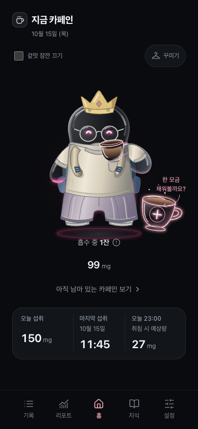
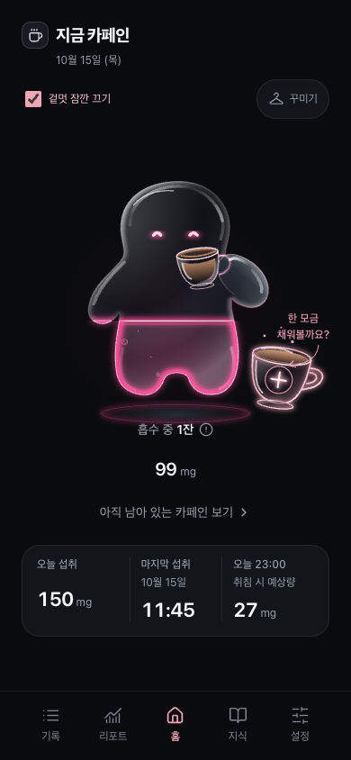

# 임시 코디 숨김과 컵 자세 소매 보정

2026-10-15, `codex/jelly-clothing-fit`의 로컬 개발 기록이다. GitHub Release 또는 토스 배포 기록이 아니다. 기존 6개 슬롯 × 50개 아이템 구성과 저장 형식은 유지한다.

## 겉멋 끄기

홈 아바타 위에 체크박스를 배치했다. 체크하면 의상과 소품을 모두 숨기고, 해제하면 저장된 코디를 다시 그린다. 캐릭터 자체, 액체 높이, 표정, 컵과 흡수 중 표현은 유지한다.

- 숨김은 `App`의 임시 표시 상태이며, 저장소의 착용 아이템을 삭제하거나 빈 코디로 저장하지 않는다.
- 기록·설정·꾸미기 등 다른 화면을 오가도 유지한다. 새로고침하거나 앱을 새로 열면 숨김을 해제한다.
- 꾸미기 화면에서는 실제 코디가 보인다. 숨긴 동안 코디를 바꿔 적용하면 홈은 계속 숨겨진 상태이고, 체크 해제 시 새 코디가 보인다.
- 착용한 아이템이 없으면 체크박스를 표시하지 않는다. 숨긴 상태에서 모두 벗긴 경우에는 숨김을 해제할 수 있도록 체크박스를 유지한다.
- 기본 체크박스와 연결된 레이블·설명을 사용한다. 레이블 터치 영역은 최소 48px이며, 키보드 Space로 조작할 수 있고 200% 텍스트에서도 줄바꿈한다.

## 컵을 든 팔의 소매

어깨 연결천과 팔 위의 소매가 서로 닿기만 하던 형태를 `RaisedSleeve`의 연속 곡면으로 합쳤다. 몸통 어깨에서 상완 바깥까지 이어지는 실루엣을 사용해 작은 조각이 붙은 듯한 경계를 줄였다.

반팔 밑단은 상완 끝을 감싸고, 긴팔은 팔꿈치를 돌아 컵 쪽 손목에서 커프가 열린다. 퍼프 소매는 볼륨과 짧은 주름을, 벨 소매는 넓게 퍼지는 밑단을 유지한다. 같은 부드러운 명암과 옅은 봉제선을 사용하고, 겹치던 윤곽선은 줄였다.

기존 상의와 추가 컬렉션이 같은 소매 표현을 사용한다. 민소매는 그대로이며, 평상시 자세와 썸네일도 변경하지 않았다. 컵·유리 팔 이후에 합성하는 기존 `sleeve` 레이어와 캐릭터 변형을 그대로 따른다.

## 검증 화면

Chrome 개발 빌드, `localhost:5175`, 375 × 812 / 390 × 844 CSS px, reduced motion 환경에서 가상 커피 기록과 6개 슬롯 코디를 사용한다. 실제 사용자 기록은 캡처에 사용하지 않는다.

| 코디 표시 | 코디 숨김 |
| --- | --- |
|  |  |

[375px 화면](previews/avatar-visibility/visible-375.png) · [200% 텍스트](previews/avatar-visibility/large-text-375.png)

## 검증 결과

- `npm run lint`, `npm run build`, `npm test` 통과. 단위 테스트는 22개 파일, 490개다. 새 의존성은 추가하지 않았다.
- 브라우저 검증은 `avatar-visibility`, `wardrobe`, `liquid-avatar`, `caffeine`의 80개 항목을 375px·390px에서 실행했다. 첫 실행은 78개 통과했고, 빈 코디에서 체크 해제 직후 제거된 입력의 상태를 `uncheck()`가 계속 기다리는 테스트 2개를 레이블 클릭과 제거 여부 확인으로 수정했다. 숨김·복원 파일 전체 6개를 재실행해 모두 통과했다.
- 각 카테고리의 50개 아이템 순회, 기존·신규 코디 저장과 복원, 컵·액체, 음료 기록·수정·삭제, 키보드·텍스트 확대를 확인했다. 숨김 전후 저장 데이터와 아바타 DOM 인스턴스도 유지된다.
- 홈에서 사용자에게 지적받은 티셔츠와 컵 자세를 직접 확인했고, 별도 갤러리에서 반팔·긴팔·퍼프·벨 소매를 검토했다. 독립 코드 리뷰에서도 기능 회귀는 발견되지 않았다.
- 기존 Vite 청크 크기 경고는 남아 있다. 빌드 JS는 698.68 kB, gzip 200.43 kB다. 실물 토스 WebView 검증·배포는 이번 로컬 검증에 포함하지 않는다.
