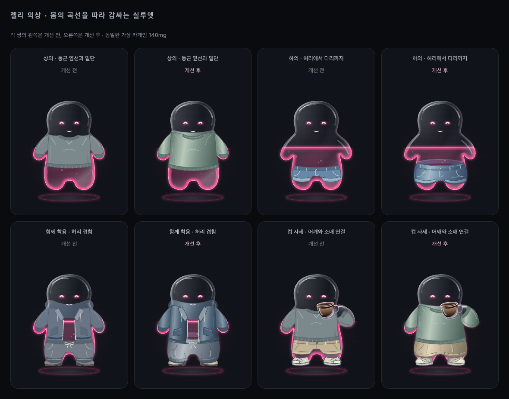
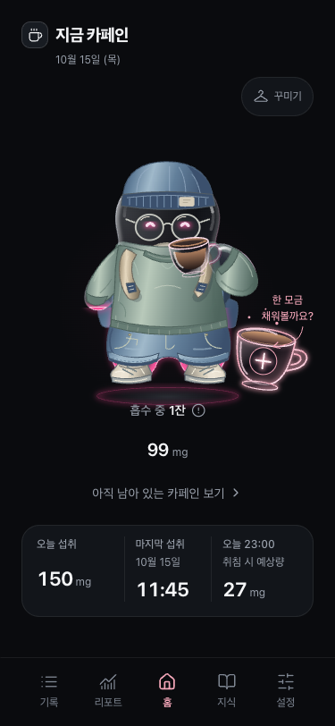
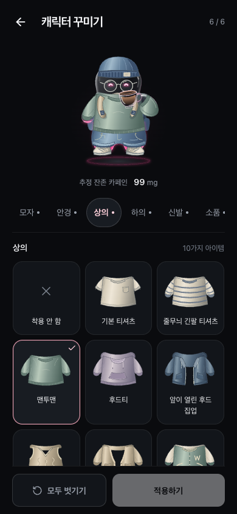

# 젤리 의상 렌더링 개선

2026-10-15, `codex/jelly-clothing-fit`의 개발 기록. 기준 코드는 `f52efd2`이며 새 기능이나 저장 형식 변경 없이 기존 60개 아이템의 형태와 재질을 다듬었다. 로컬 개발 화면이며 GitHub Release·토스 배포 화면이 아니다.

## 몸을 감싸는 의상

상의는 어깨에서 겨드랑이와 허리 옆면까지 이어지는 곡선으로 넓혔다. 뒤쪽 목둘레와 후드는 몸 뒤에, 몸통 앞판과 소매는 몸 앞에 놓는다. 앞판의 밝은 부분과 양쪽의 어두운 부분, 옆선 주름, 둥근 밑단이 같은 몸의 볼륨을 설명하도록 맞췄다. 열린 후드 집업과 카디건은 앞섶이 몸통을 따라 휘어지며 가운데 젤리가 보인다.

하의는 뒤쪽 허리와 밑단 안쪽을 `back`, 골반·다리·앞쪽 허리선을 `body` 레이어로 나눴다. 허리는 평평한 가로선 대신 몸 둘레를 도는 곡선이며, 반바지는 둥근 골반에서 짧은 다리의 입구로 이어진다. 긴 바지는 발목까지 내려오고, 스커트는 허리에서 퍼지는 주름과 뒤쪽 밑단으로 깊이를 만든다.

몸 앞에서는 신발 → 하의 → 상의 순서로 그린다. 상의의 굽은 밑단이 하의의 앞 허리선을 살짝 덮어 경계가 끊기지 않는다. 스커트와 바지는 부츠 목을 덮고 신발 앞코가 드러난다. 뒤쪽에서는 백팩·케이프를 목둘레와 허리보다 먼저 그려 후면 소품이 옷의 가장자리를 가리지 않게 했다.

컵을 들 때는 어깨 연결천을 몸통 레이어에 남기고, 컵·유리 팔을 그린 다음 굽힌 팔 바깥쪽 소매를 기존 `sleeve` 레이어로 합성한다. 커프가 손을 향해 비스듬히 열려 컵과 유리 손이 보인다. 반팔은 짧은 어깨·상완 캡을 사용하며, 조끼는 민소매 형태를 유지한다.

## 공통 재질

- 크림·네이비·차콜·데님·세이지와 낮은 채도의 파스텔을 공유한다. 핑크는 일부 아이템의 포인트로 유지한다.
- `GarmentSurface`는 양쪽 음영과 부드러운 왼쪽 하이라이트를 SVG 선형 그라디언트로 표현한다. 기본 윤곽선은 1.15 SVG 단위이며, 세부 봉제선·커프는 더 약한 명암을 쓴다.
- 가방·모자·신발도 같은 팔레트와 재질을 사용한다. 백팩 끈은 상의 위에서 팔 안쪽으로 지나가고, 신발 입구는 어두운 안쪽과 앞쪽 테두리로 구분한다.
- 투명 레인 재킷은 낮은 불투명도를 유지한다. 새 blur·filter·애니메이션·라이브러리는 추가하지 않았다.
- 미리보기와 목록은 같은 SVG를 사용한다. 늘어난 목둘레와 뒤 허리선이 잘리지 않도록 상·하의 썸네일의 viewBox를 넓혔다. 그라디언트 ID는 인스턴스별 `useId`로 분리한다.

카페인 계산, 액체 높이·중력, 표정, 컵 애니메이션, 저장소·선택·해제·복원, 아이템 ID와 6개 슬롯별 10개 구성은 변경하지 않았다. 의상은 기존 `.avatar-shape` 아래에 있어 몸의 회전·크기·떠 있는 움직임을 함께 따른다.

## 개발 화면

Chrome 개발 빌드, `localhost:5175`, 가상 기록, reduced motion 환경에서 촬영했다. 홈과 꾸미기는 375 × 812 / 390 × 844 CSS px이다. 비교판은 1180 × 927, 아이템 전체 판은 1400 × 850 CSS px이며 같은 캐릭터 컴포넌트를 정적으로 배열했다. 실제 사용자 기록은 사용하지 않았다.

| 홈 375px | 꾸미기 390px |
| --- | --- |
|  |  |

[혼합 코디 10종](previews/jelly-clothing-fit/outfits.png) · [상의 10종의 컵 자세](previews/jelly-clothing-fit/tops-drinking.png) · [홈 390px](previews/jelly-clothing-fit/home-390.png) · [꾸미기 375px](previews/jelly-clothing-fit/wardrobe-375.png)

## 검증

- 기존 의존성을 설치했으며 새 패키지는 추가하지 않았다.
- `npm run lint`: 오류·경고 없이 통과. `npm run build`: 통과. JS 번들이 506.27 kB(압축 148.10 kB)여서 Vite의 500 kB 크기 경고는 남아 있다.
- `npm test`: 22개 파일, 488개 통과.
- `wardrobe`, `liquid-avatar`, `liquid-gravity`, `caffeine`, `android-back`, `tilt-animation-setting`의 98개 브라우저 항목을 375px·390px에서 실행했다. 처음 96개가 통과했고, 기존 카페인 테스트 두 개의 시간 조건을 보정했다. `clock.install` 뒤 실제 시간이 흘러 기록이 16.628초 늦어졌던 테스트는 `setFixedTime`으로 고정하고, 기록부터 편집·삭제까지 이어지는 종합 테스트는 제한 시간을 60초로 늘렸다. 기대 카페인값과 제품 계산 코드는 변경하지 않았다.
- 수정한 두 테스트, 60개 아이템 순회, 스커트·부츠와 전체 썸네일 경계를 두 해상도에서 다시 실행한 8개 항목이 모두 통과했다. 따라서 최초 실행과 재검증을 합쳐 98개 회귀 항목을 확인했다.
- 검증 서버는 `npm run dev -- --port 5175`로 실행하고 임시 Playwright 설정에서 같은 포트를 지정했다. 원래 서버 설정과 main 작업 폴더는 변경하지 않았다.
- 375px와 390px에서 6개 부위 목록을 순회하며 미리보기·썸네일 SVG ID 중복과 깨진 색상 참조가 없는지 확인했다. 모두 정상이며 가로 넘침·페이지 오류가 없었다.
- 일반 자세·컵 자세의 상의 10종, 하의 10종, 혼합 코디, 소품·신발 전체를 캡처해 비교했고 독립 코드·이미지 리뷰를 완료했다.

실물 토스 앱에서의 성능·센서 확인은 이번 로컬 브라우저 검증에 포함하지 않는다.
