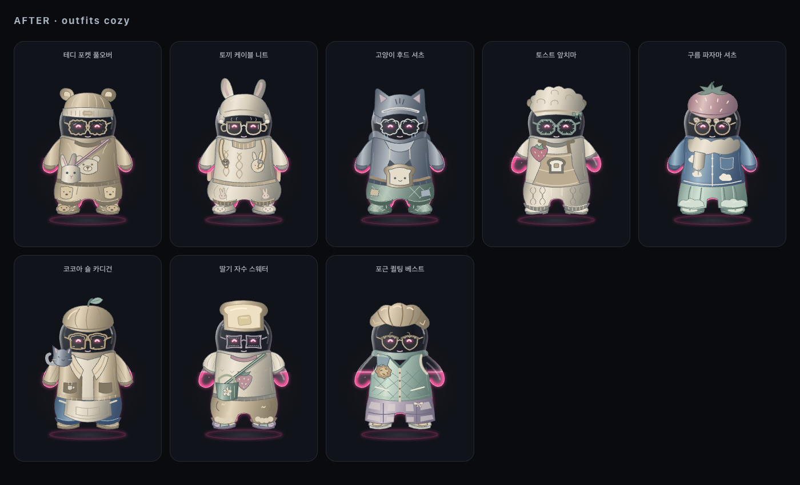
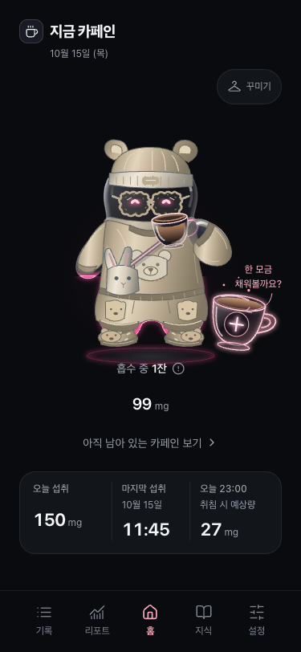
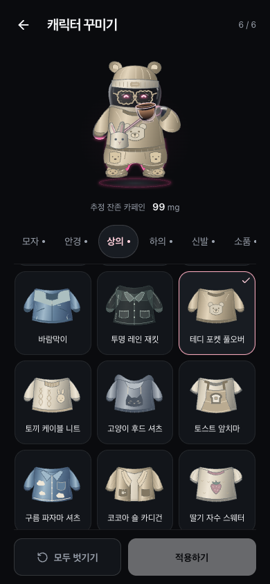

# 젤리 꾸미기 300종 컬렉션

2026-10-15, `codex/jelly-clothing-fit`의 개발 기록. 기존 60종을 보존하고 240종을 추가했다. 모자·안경·상의·하의·신발·소품은 각각 50종이며, 저장 형식과 카페인 계산은 그대로다. 현재 로컬 개발 브랜치의 내용이며 GitHub Release·토스 배포에 포함됐다는 의미는 아니다.

## 구성과 디자인

각 슬롯은 기본 10종 + 다섯 컨셉 × 8종으로 구성한다. 새 아이템마다 이름과 고유 ID, SVG 그림을 직접 정의했다. 색을 바꿔 같은 그림을 늘리는 방식 대신 재단·실루엣·장식의 차이를 만들었다.

| 컨셉 | 주요 모티프 | 아이템 예 |
| --- | --- | --- |
| 포근한 (`cozy`) | 동물·빵·니트·누빔 | 곰돌이 니트캡, 토끼 케이블 니트, 토끼 블루머, 곰돌이 룸 슈즈 |
| 로맨틱 (`romantic`) | 꽃잎·리본·레이스·진주 | 레이스 보닛, 리본 타이 블라우스, 꽃잎 랩 스커트, 발레 리본 슈즈 |
| 스트리트 (`street`) | 스포츠·데님·패널·유틸리티 | 파이브 패널캡, 플라이트 봄버, 파라슈트 팬츠, 테크 삭스 스니커 |
| 클래식 (`classic`) | 세일러·테일러링·체크·가죽 | 캡틴 정모, 더블 브레스티드 재킷, 세일러 단추 쇼츠, 윙팁 옥스퍼드 |
| 판타지 (`fantasy`) | 숲·달·별·요정·모험 | 초승달 마법사모, 숲지기 잎사귀 튜닉, 고사리 요정 치마, 별 지팡이 |

상의는 둥근 몸의 양옆까지 이어지는 9개 재단과 긴팔·반팔·퍼프·벨·민소매 구조를 기반으로 개별 목선·포켓·앞섶·자수·트림을 더한다. 하의는 골반을 감싼 뒤 짧은 다리로 이어지는 10개 재단을 사용하며, 허리 뒷부분과 밑단 안쪽을 후면에 둔다. 신발은 슬리퍼·로퍼·부츠 등 11개 구조에 발등·끈·밑창 차이를 더한다.

상의 밑단이 하의 허리선을 살짝 덮고, 바지나 스커트가 신발 목을 덮는 기존 레이어 순서를 유지했다. 컵 자세에서는 어깨 연결천과 굽힌 팔 소매를 분리한다. 망토·날개·백팩은 앞뒤를 나눠 몸을 감싸고, 가방 끈과 브로치는 앞쪽에 놓는다. 크림·차콜·네이비·데님·세이지·은은한 파스텔과 공통 `GarmentSurface` 재질로 명암을 맞췄다.

## 코드와 호환성

- `data/collections/`: 여섯 슬롯의 신규 아이템과 컨셉·형태 정보. `avatarCatalog.ts`에서 기본 60종과 합친다.
- `graphics/collections/`: 여섯 슬롯의 신규 SVG. 기존 `AvatarItemGraphic`이 ID별 렌더러를 선택하며 기본 아이템은 원래 렌더러를 사용한다.
- `TopCollectionShapes.tsx`: 반복되는 몸통·소매·목선·밑단 표현만 공유한다. 범용 아바타 엔진이나 새 라이브러리는 도입하지 않았다.
- `AvatarItemThumbnail`: 실제 착용 SVG를 그대로 사용하며 `memo`로 선택할 때 정적인 썸네일의 재렌더링을 줄인다. 작은 브로치·키링은 `accessoryThumbnailBoxes.ts`의 개별 구도로 목록에서 알아보기 쉽게 맞췄다.
- 부위별 아이템 ID만 저장하는 `caffeine-tracker:avatar:v1`과 기존 60개 ID를 유지한다. 신규 `concept` 정보는 카탈로그에만 있으며 저장 문서에 추가하지 않는다.
- 홈·꾸미기 미리보기·목록은 같은 그림을 사용한다. 기존 액체·표정·컵·움직임, 선택·해제·적용·저장 실패 처리, 키보드 탭 이동을 유지한다.
- 카테고리 탭과 아이템 목록 구조를 유지하며, 제거 요청한 아이템 개수 문구는 다시 넣지 않았다.

## 개발 화면

Chrome 개발 빌드, `localhost:5175`, reduced motion 환경에서 촬영했다. 테마별 갤러리는 1400 × 850 CSS px이며 가상 추정 잔존량 140mg을 전달한 캐릭터 컴포넌트 8개를 배치했다. 아래는 6개 슬롯을 모두 조합한 예로, 각 아이템을 서로 자유롭게 조합할 수 있다.

[로맨틱](previews/jelly-collection/romantic.png) · [스트리트](previews/jelly-collection/street.png) · [클래식](previews/jelly-collection/classic.png) · [판타지](previews/jelly-collection/fantasy.png)

홈과 꾸미기는 375 × 812 / 390 × 844 CSS px로 촬영했다. 2026-10-15 12:00 KST를 기준으로 11:45에 150mg을 기록한 가상 데이터를 사용했으며, 실제 사용자 저장소는 사용하지 않았다. 꾸미기 화면은 새 상의가 보이도록 아이템 목록만 스크롤한 상태다.

| 홈 375px | 꾸미기 390px |
| --- | --- |
|  |  |

[홈 390px](previews/jelly-collection/home-390.png) · [꾸미기 375px](previews/jelly-collection/wardrobe-375.png)

## 검증

- `npm run lint`, `npm run build` 통과. 단위 테스트 22개 파일, 490개 통과.
- JS 번들 698.13 kB, gzip 200.15 kB. 기존에 있던 Vite의 500 kB 경고는 유지되며, 300종의 SVG를 현재 앱 번들에 포함한다.
- 300개 모두 고유 ID·이름과 슬롯당 50개, 신규 컨셉당 8개를 확인했다. 전체 아이템이 기존 저장 형식으로 직렬화·복원된다.
- 실제 모바일 DOM에서 300개 썸네일의 빈 그림·viewBox 잘림·색상을 제외한 동일 형태 중복이 0건이다.
- 신규 240종을 컨셉별로 캡처해 시각 검토했다. 상의의 일반·컵 자세와 전체 코디, 하의·신발 연결부도 확인했다.

- 375px·390px에서 `wardrobe` 44개, `liquid-avatar` 12개, `caffeine` 18개, `liquid-gravity` 10개의 총 84개 고유 회귀 항목을 확인했다. 300개 선택 순회, 썸네일 경계·SVG ID·색상 참조, 기본·신규 아이템 저장과 복원, 5개 컨셉의 6부위 착용, 컵 자세, 키보드·확대 글자, 저장 실패·네이티브 뒤로가기, 카페인 기록·수정·삭제, 액체·중력을 포함한다.
- 최초 74개 실행에서는 71개가 통과했다. 키보드 발광 테스트는 실제 로그에서 키 입력 완료까지 1.1초가 걸려 900ms 효과가 검사 전에 사라졌다. 가상 시계를 멈추고 테스트가 명시적으로 시간을 진행하도록 보정했다. 네 가지 액체 상태를 재로딩하는 테스트는 전체 제한을 60초로 늘렸다. 기대값과 제품의 타이머·계산 코드는 변경하지 않았다.
- 음료 선택 복귀 테스트 한 건도 전체 30초 제한을 넘었다. 해당 코드와 검증 조건은 바꾸지 않고 브라우저 작업을 직렬화해 재실행했다. 위 세 시나리오를 두 해상도에서 실행한 6개 항목이 모두 통과했고, 액체 중력 10개 항목도 별도 실행에서 모두 통과했다.
- 홈·꾸미기의 가상 기록 캡처 4장과 신규 6부위 조합 40착장의 일반·컵 자세 80개를 시각 검토했다. 문서 가로 넘침과 페이지 오류는 없었다. 375px 카테고리 탭은 기존 가로 스크롤 구조를 유지한다.
- 최종 ESLint와 `git diff --check`도 통과했다. 검증에는 5175 포트를 지정한 임시 Playwright 설정을 사용했으며 main 작업 폴더·원래 서버 설정은 변경하지 않았다.

실물 토스 앱의 기기 성능·센서 확인과 배포는 이 검증에 포함하지 않는다.
