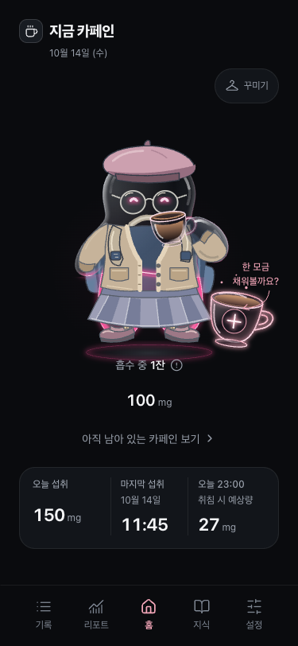
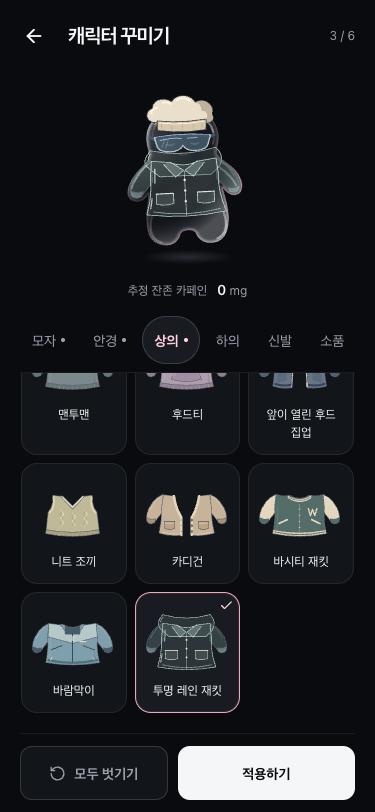

# 젤리 캐릭터 꾸미기

2026-10-14 개발 브랜치 `codex/jelly-wardrobe-isolated`의 구현 기록. GitHub Release와 토스 배포는 하지 않았다. 기존 v1.1.0 화면·버전은 변경하지 않는다.

## 구조

- `src/features/avatar/data/avatarCatalog.ts`: 6개 부위와 60개 아이템 정보.
- `model/avatar.ts`: 알 수 없는 ID·잘못된 부위는 해당 부위만 해제한다.
- `graphics/`: 머리·소품과 상의·하의·신발의 실제 SVG. 썸네일과 착용은 같은 그래픽을 쓴다.
- `CaffeineBodyVisual`: 기존 `.avatar-shape`의 공통 변환 안에서 뒤 소품 → 몸·액체 → 의상 → 얼굴 → 앞 소품·모자·안경 → 컵·팔 → 들린 소매를 합성한다. 액체의 중력 프레임에는 의상을 넣지 않는다.
- `WardrobePage`: 저장 상태를 복사한 미리보기, 부위 선택, 해제, 적용. 선택만으로 저장하거나 센서 권한을 요청하지 않는다. 목록 썸네일에는 센서·애니메이션이 없다.
- `useAvatar` / `AvatarStore`: 저장 완료 이후에만 적용 상태를 공개한다. 동시 쓰기는 막고, 읽기 오류는 재시도를 요구한다.
- `LocalAvatarRepository`: 기존 토스/브라우저 저장 어댑터를 재사용한다. `caffeine-tracker:avatar:v1` 키에 `{ version: 1, outfit }`을 저장하며 카페인 문서와 독립적이다. 기존 사용자는 모두 미착용 상태로 시작한다.
- `/wardrobe`: 기존 History API 라우터로 진입한다. 화면·브라우저·토스 뒤로가기로 나가면 미저장 선택이 폐기된다. 저장 응답은 화면 인스턴스와 방문 ID를 검사해 이전 방문이 새 화면을 닫지 않도록 한다.

현재 기기에만 저장하며, 다른 계정/기기로 동기화하지 않는다. 앱 데이터 초기화는 기록과 함께 착용 상태도 초기화한다. 저장한 SVG 이미지 자체는 보관하지 않는다.

## 공식 문서 확인

연결된 Apps in Toss 문서 MCP에서 2026-10-14 확인했다.

- [Storage](https://developers-apps-in-toss.toss.im/documentation/sdk/domains-api/storage): `getItem`, `setItem`, `removeItem`을 사용하는 기존 어댑터 재사용.
- [graniteEvent](https://developers-apps-in-toss.toss.im/documentation/sdk/events/graniteevent): 기존 `backEvent` 구독을 통한 내부 화면 뒤로가기.
- [Screen.setIosSwipeBack](https://developers-apps-in-toss.toss.im/documentation/sdk/domains-api/screen/screen.setiosswipeback): 기존 오버레이 스와이프 정책 유지.

## 검증 범위

`tests/wardrobe.spec.ts`는 선택·교체·명시적 해제·전체 해제, 미리보기 취소, 적용·새로고침 복원, 토스 저장 실패·읽기 실패·재시도, 중복 적용, 저장 중 뒤로가기·재진입, 60개 실제 그래픽과 정적 썸네일, 캐릭터 인스턴스 유지, 키보드·200% 글자 확대·작은 높이, 혼합 코디·여러 카페인 상태·컵 자세를 다룬다.

토스 브라우저 검증은 설치된 SDK의 브리지 프로토콜을 모사한 테스트 호스트를 사용한다. 실물 Android/iOS 토스 앱에서의 확인은 별도이며, 로컬 검증만으로 토스 배포를 주장하지 않는다.

## 독립 실행

다른 작업과 분리한 Git worktree에서 개발한다. `npm run dev`와 `npm run preview`는 5174 포트를 사용하며 Playwright도 `http://127.0.0.1:5174`로 연결한다. 기존 프로젝트의 5173 서버는 재사용하지 않는다.

## 개발 화면

아래 화면은 375 × 812 CSS px, Chrome 브라우저 개발 빌드, 가상 기록으로 촬영했다. 배포 버전의 스크린샷이 아니다.

| 홈의 혼합 코디·컵 자세 | 꾸미기 화면 |
| --- | --- |
|  |  |

[모자·안경·소품 30종](previews/jelly-wardrobe/head-items.png) · [상의·하의·신발 30종](previews/jelly-wardrobe/clothing-items.png) · [스커트와 부츠의 레이어 검증](previews/jelly-wardrobe/skirt-boots-375.png)

## 검증 결과 (2026-10-14)

- `npm install --ignore-scripts --no-audit --no-fund`: 기존 의존성 설치, 새 라이브러리 추가 없음.
- `npm run lint`, `npm run build`: 통과.
- `npm test`: 22개 파일, 488개 테스트 통과.
- `npx playwright test tests/wardrobe.spec.ts tests/liquid-avatar.spec.ts tests/liquid-gravity.spec.ts tests/caffeine.spec.ts tests/android-back.spec.ts tests/tilt-animation-setting.spec.ts --workers=4`: 375 × 812 / 390 × 844에서 98개 항목 검증. 최초 93개 통과, 브라우저 조작 지연 4개와 발광 타이머 판정 1개 재검증. 발광 검증 시간을 고정한 뒤 `npx playwright test --last-failed --workers=1`에서 나머지 5개 모두 통과.
- 독립 코드 리뷰에서 발견한 스커트/부츠 레이어 겹침을 수정하고, 실제 SVG 도형의 그리기 순서와 모든 썸네일 경계를 검증하는 회귀 테스트를 추가했다.
- 기존 원본 폴더는 main과 다른 작업의 미커밋 변경을 보존했다. 이 기능은 별도 worktree·5174 포트에서 검증했다.

## 후속 비주얼 개선

상의·하의의 몸을 감싸는 실루엣과 재질, 음용 소매를 다듬은 내용은 [2026-10-15 렌더링 개선 기록](jelly-clothing-fit.md)에 별도로 남겼다. 위 화면과 검증 결과는 최초 구현 당시의 기록이다.
